# Writing for Chain of Thoughts

Use this guide as a copy-and-paste reference while writing. The source examples and screenshots are preserved from the temporary Article Playground, which was removed from the blog after the screenshots were completed. The examples below retain the same words, code, and captions shown in the images. Ordinary Markdown (`index.md`) supports everything below; use `index.mdx` only when you need imported components. Fonts, colors, and spacing come from the shared article styles.

Each example pairs source code with a screenshot of its output. All sixteen screenshot files are present in **`docs/images/author-guide/`**, relative to the repository root, and all embedded screenshot links resolve. All screenshots have passed visual review against their examples. These documentation images are separate from the images inside a blog article. The [capture checklist](#screenshot-capture-checklist) lists every filename and what to include.

The playground is no longer a blog entry or a preview route. Its `draft: false` metadata below is preserved only as an example; start your own unpublished articles with `draft: true`.

## Start a post

Create one directory per article, keeping its images alongside it. The temporary playground used this structure:

```text
src/content/blog/article-playground/
├── index.md
└── images/
    ├── hello-world.png
    └── learning-loop.svg
```

Its frontmatter demonstrates all the blog metadata:

```yaml
---
title: "The Article Playground"
description: "A temporary showcase of every supported article element, from quiet paragraphs to wide diagrams and margin notes."
pubDate: 2026-11-10
updatedDate: 2026-11-10
slug: article-playground
tags:
  - temporary
  - authoring
  - design
# Visible for local review. Set to true or remove this entry before publishing.
draft: false
cover:
  image: ./images/hello-world.png
  alt: "Hello World lettering surrounded by colorful illustrations of code, cloud computing, architecture, and software tools."
---
```

**Rendered example:** the title and description lead, followed by published/updated dates, tags, and the cover image. Capture the top of the playground for `ag_img_01.png`.

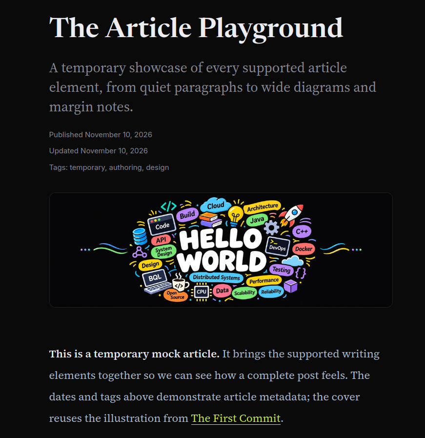

When starting your own post, replace the title, description, dates, tags, cover, and slug, and begin with `draft: true`. Keep your chosen image files beside your own entry.

- `title`, `description`, `pubDate`, and `slug` are required.
- The layout supplies the title, description, dates, and tags. Do not repeat the title as a `#` heading in the body.
- `slug` determines the public URL: for example, `slug: your-article` produces `/blog/your-article/`. Use a unique slug with lowercase letters/numbers separated by single hyphens. Do not use `index`, spaces, slashes, or a file extension.
- Keep a published slug unchanged when renaming or moving the source folder.
- Use `YYYY-MM-DD` dates. Dates are displayed in UTC.
- Optional `updatedDate` adds an updated date. Tags default to an empty list.
- **Drafts are excluded from both local preview routes and production routes.** Temporarily set `draft: false` while previewing locally. Restore `true` before committing if the article is not ready to publish.

## Headings and the table of contents

This is the complete “Paragraphs and emphasis” section from the playground, including the text between heading levels. The same words and hierarchy will appear in your screenshot:

```md
## Paragraphs and emphasis

An ordinary paragraph should be comfortable to read before anything else draws attention. This one is deliberately long enough to wrap across several lines, letting us judge the body font, line spacing, and reading width together. The layout should still feel calm when a paragraph contains **a strong phrase**, *a quieter aside*, and an identifier such as `article-playground`.

A second paragraph shows the space between thoughts. We can combine ***bold and italic emphasis***, show ~~a discarded phrase~~, and return to the main idea without introducing another component. The important words should stand out while the surrounding sentence stays readable.

### A subsection in the contents

Second- and third-level headings appear in the table of contents. On a wide screen, the contents sit to the left of the reading column; on a smaller screen, they become a disclosure above the article. Use the contents to jump to [images and captions](#images-and-captions), then return to this section.

#### A smaller topic

Fourth-level headings divide a subsection without adding another navigation item.

##### A smaller detail

Fifth-level headings are available when a subject needs one more layer of structure.

###### The smallest detail

Sixth-level headings complete the hierarchy. Most articles will need only the first two or three levels, but this page lets us inspect all of them in order.
```

**Rendered example — large desktop:** a left-hand table of contents and a hierarchy of serif headings in the article. At 1,440px (90rem) and above, click the contents summary to keep the full list expanded while capturing it. Use `ag_img_02.png`; a tall crop is fine if needed to include H2–H6.

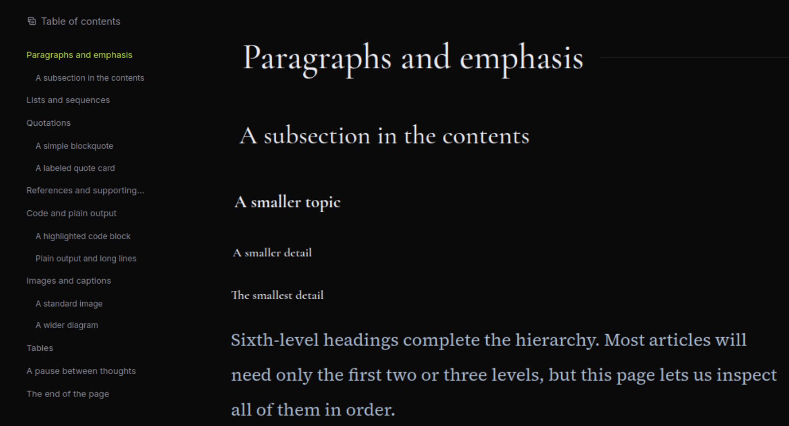

**Rendered example — phone:** the contents move above the article body and can be opened or closed. Expand them before taking `ag_img_03.png`.

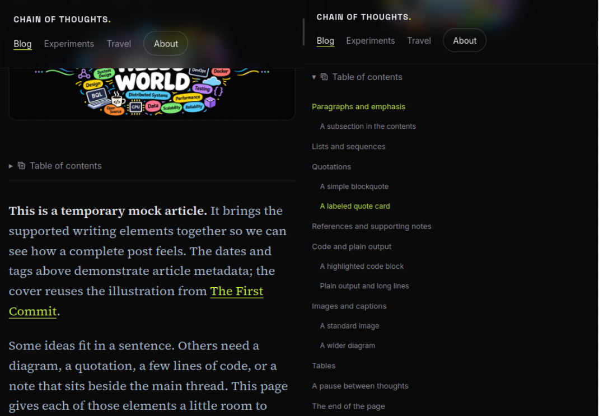

Only `##` (H2) and `###` (H3) appear in the blog/experiment table of contents. H3 links are indented. H4–H6 remain available in the article but do not clutter the navigation. Use headings in order instead of skipping levels to change their appearance.

Main H2 sections receive a decorative line automatically. You do not need to write a horizontal rule after each heading. The contents and section links are generated automatically. Heading links account for the persistent site header when you jump to a section.

Between 768px and 1,439px, notes use the right margin while the contents remain a disclosure above the body.

## Paragraphs and emphasis

Separate paragraphs with a blank line. These paragraphs are copied from the playground:

```md
An ordinary paragraph should be comfortable to read before anything else draws attention. This one is deliberately long enough to wrap across several lines, letting us judge the body font, line spacing, and reading width together. The layout should still feel calm when a paragraph contains **a strong phrase**, *a quieter aside*, and an identifier such as `article-playground`.

A second paragraph shows the space between thoughts. We can combine ***bold and italic emphasis***, show ~~a discarded phrase~~, and return to the main idea without introducing another component. The important words should stand out while the surrounding sentence stays readable.
```

**Rendered example:** serif paragraphs with distinct emphasis and a small highlighted inline-code treatment. Capture the first two paragraphs under “Paragraphs and emphasis” for `ag_img_04.png`.

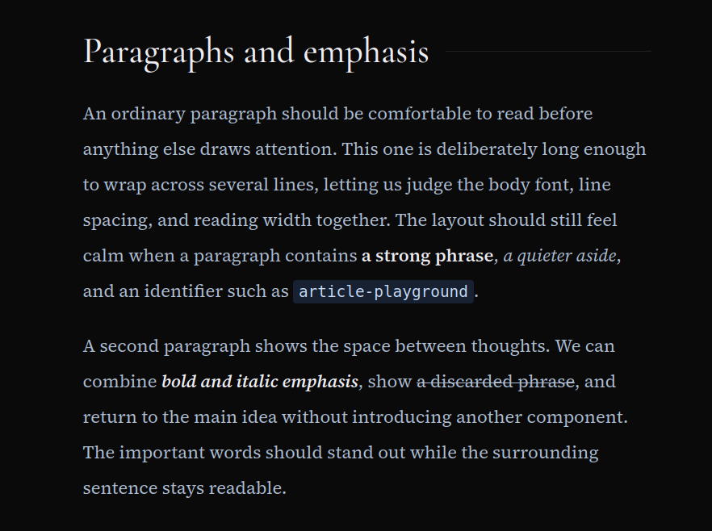

Use `**bold**`, `*italic*`, `***bold and italic***`, `~~strikethrough~~`, and backticks for `inline code` as needed.

## Lists and sequences

Use bullets for related observations and numbers for a sequence. Indent nested items beneath their parent:

```md
## Lists and sequences

A bulleted list collects related observations:

- Keep the main idea close to the start of a paragraph.
- Give supporting material a clear place to live.
  - A short aside can stay in the sentence.
  - A longer explanation can become a footnote.
- Let images and code carry information that prose would make harder to follow.

A numbered list describes a sequence:

1. Write an opening paragraph that establishes the subject.
2. Add the examples that make the idea concrete.
   1. Check a code sample independently.
   2. Read a diagram alongside its caption.
3. Read the whole article at a narrow width as well as on a large screen.
```

**Rendered example:** bullets and numbers align with the reading column; nested items are indented. Capture both lists in “Lists and sequences” for `ag_img_05.png`.

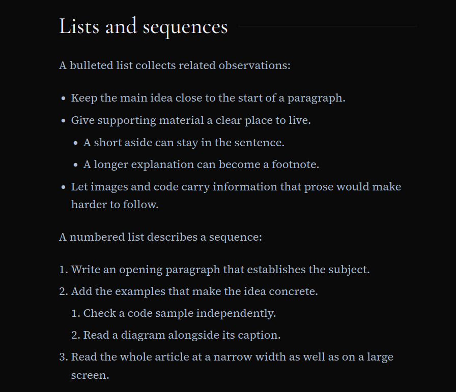

## Quotations

### Simple quotation

Use `>` for each paragraph of a quotation. The playground uses original sample copy:

```md
> A useful page gives the main thought a clear path and the supporting details somewhere to rest.
>
> A second paragraph lets us check how a longer quotation holds together inside the same block.
```

**Rendered example:** a quotation with its own border, background, spacing, and quotation font. Capture the entire two-paragraph blockquote for `ag_img_06.png`.

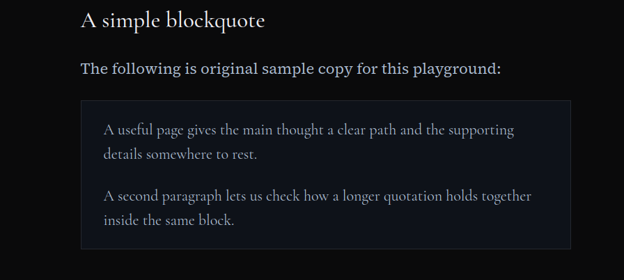

### Quote card with a label and source

Use this HTML wrapper when a quote needs a label and attribution. This is the playground's card; use your actual quote and source when writing an article:

```html
<figure class="quote-card">
  <figcaption class="quote-label">A note on writing</figcaption>
  <blockquote>
    <p>Give the idea enough space to become clear. Use <em>emphasis</em> with care, and let the <strong>example</strong> do some of the explaining.</p>
  </blockquote>
  <p class="quote-source">Article playground · <cite><a href="#paragraphs-and-emphasis">Original sample text</a></cite> · 2026</p>
</figure>
```

**Rendered example:** a labeled card with the quotation in the middle and an attribution link below. Include all three parts in `ag_img_07.png`.

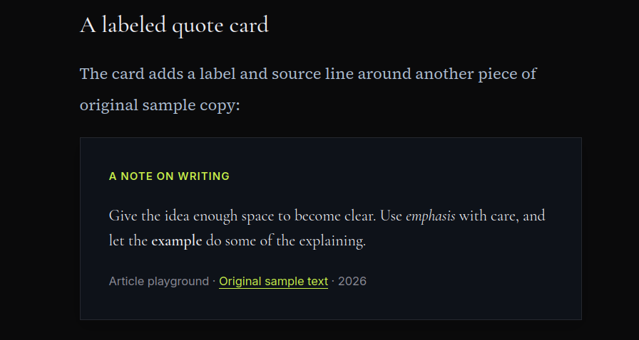

The label and source line are optional. Remove the whole relevant element if you do not need it. Inside this HTML card, use HTML for emphasis or links (`<em>`, `<strong>`, `<a>`), rather than Markdown stars or link syntax.

## References and supporting notes

Use a footnote marker where the extra information belongs and define it at the end of the file. These are the complete paragraphs from the playground’s “References and supporting notes” section, followed by their matching definitions. In the article file, the definitions live at the end:

```md
A footnote can hold a short explanation without interrupting the paragraph.[^short-note] On tablets and computers, notes sit in the right margin beside their references. On phone-sized screens below 768px, the same notes remain at the end with links back to the text.

A longer note tests wrapping, emphasis, and links in the supporting text.[^long-note] Reusing a note marker also gives us a way to inspect multiple return links.[^short-note]

For a direct link, visit the [blog listing](/blog/) or the [About page](/about/). A [reference-style link][first-commit] keeps a repeated destination out of the middle of the source. The same destination can be used again when we return to [the original article][first-commit].

[^short-note]: A short supporting note with *a little emphasis*.
[^long-note]: A longer note gives the margin enough text to wrap across several lines. It can include **emphasis**, `inline code`, and a link back to [The First Commit](/blog/hello-world/), while leaving the main paragraph focused on its subject.
```

**Rendered example — computer or tablet:** numbered markers in the text with their notes beside the relevant paragraphs. For `ag_img_08.png`, capture the “References and supporting notes” paragraphs **and the right margin in the same image**. Keep the longer note and its return links visible.

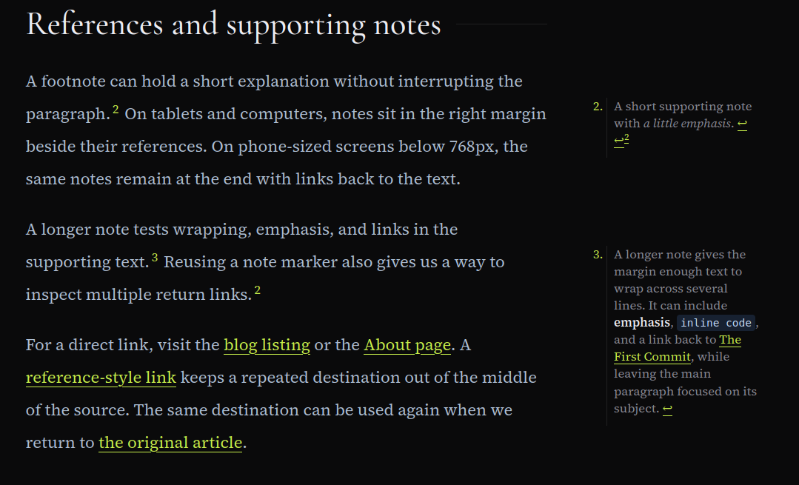

For the phone screenshot, this is the playground’s complete final section and its end-of-file note definitions. Notes referenced earlier in the article also appear in the endnote list:

```md
## The end of the page

This final section gives the contents one more destination and lets us inspect the transition to the site footer. On a phone-sized screen, the supporting notes appear between this paragraph and the footer. On tablets and computers, they should already be beside the passages they explain.

Return to [the start of the examples](#paragraphs-and-emphasis) or [all blog articles](/blog/).

[^playground]: This page contains demonstration copy, not a new personal essay. It is temporarily visible for design review.
[^short-note]: A short supporting note with *a little emphasis*.
[^long-note]: A longer note gives the margin enough text to wrap across several lines. It can include **emphasis**, `inline code`, and a link back to [The First Commit](/blog/hello-world/), while leaving the main paragraph focused on its subject.
[^diagram]: The diagram is an existing illustrative placeholder. Its labels describe a conceptual loop; it does not document a real project or travel experience.

[first-commit]: /blog/hello-world/
```

**Rendered example — phone:** notes collect at the article end, with return links back to the text. For `ag_img_09.png`, scroll to the notes below “The end of the page” at a width below 768px.

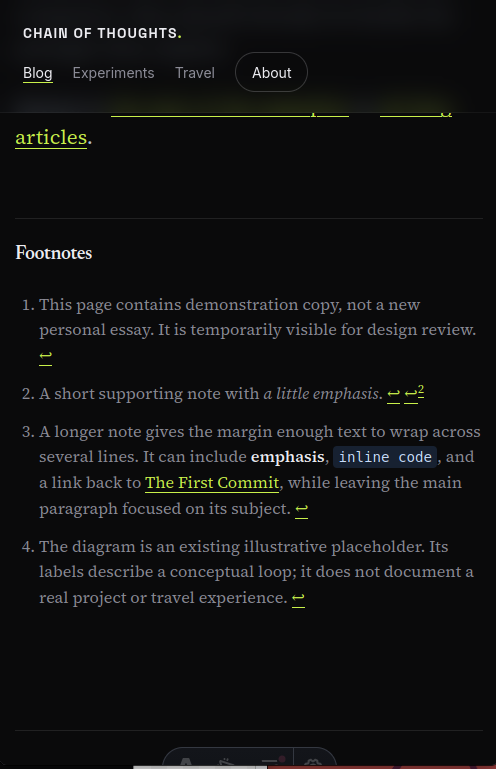

- Names such as `short-note` are local identifiers. Match the marker to its definition; use a different name for each distinct note.
- The site generates visible numbers and return links. The first visible number depends on earlier notes in the article; the playground already has a note in its introduction.
- Reuse a marker to point to the same note again. The note gets return links for its references.
- Put definitions at the end of the file to keep the article source easy to read.
- At viewport widths of 768px (48rem) and above, blog/experiment notes appear in the right margin. Below that phone breakpoint, they appear at the article end, before the site footer. Without JavaScript, they remain ordinary endnotes.

An ordinary source link belongs directly in the sentence when readers do not need an additional explanation. A footnote is useful for citations or supporting information that would interrupt the paragraph.

## Links

This is the exact linked paragraph shown in the playground’s “References and supporting notes” section:

```md
For a direct link, visit the [blog listing](/blog/) or the [About page](/about/). A [reference-style link][first-commit] keeps a repeated destination out of the middle of the source. The same destination can be used again when we return to [the original article][first-commit].
```

The reference-style links use this definition at the end of the article:

```md
[first-commit]: /blog/hello-world/
```

**Rendered example:** linked words receive the shared lime color and underline. For `ag_img_10.png`, crop to the final paragraph of “References and supporting notes,” beginning **“For a direct link, visit…”** and ending **“…the original article.”** Include the full paragraph with its lime underlined links; the heading and right-margin notes are not needed in this crop.

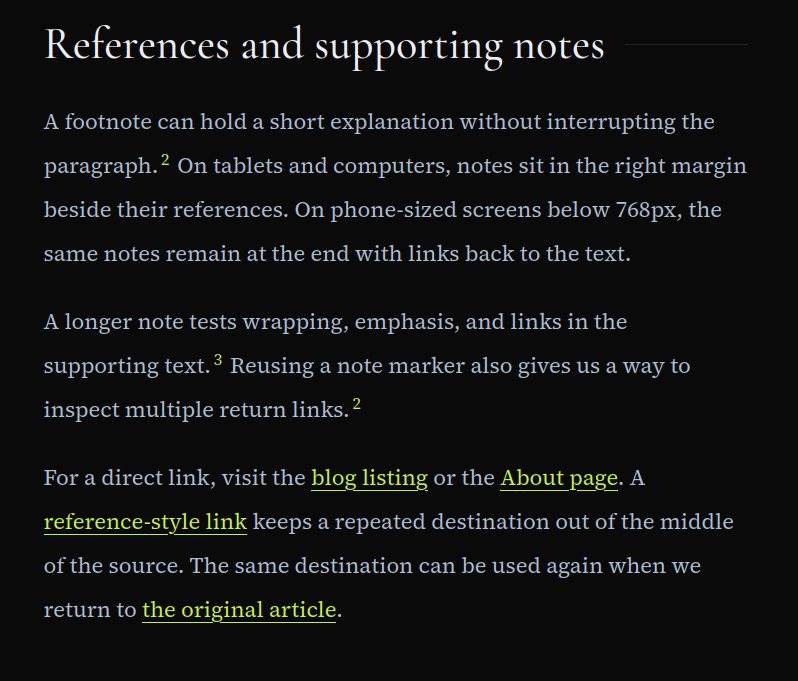

External links use the same syntax with a full URL, for example `[Source title](https://example.com/article)`. A reference-style link renders as an ordinary link; it does not create a numbered footnote.

The heading `## Images and captions` generates `#images-and-captions`. For punctuation or repeated headings, check the generated table-of-contents link instead of guessing the anchor.

## Code

Use backticks for code inside a sentence:

```md
Use inline code for a filename such as `index.md`, a property such as `draft`, or a command such as `npm run build`.
```

The paragraph screenshot `ag_img_04.png` above also shows inline code. For a block, put triple backticks on their own lines and name the language after the opening fence. This is the complete TypeScript example from the playground:

````md
```ts
type Note = {
  title: string;
  tags: string[];
};

const note: Note = {
  title: 'A small observation',
  tags: ['writing', 'experiments'],
};

function describeNote({ title, tags }: Note): string {
  return `${title} — ${tags.join(', ')}`;
}

console.log(describeNote(note));
```
````

**Rendered example:** a bordered code block with colored syntax, line numbers, a language label, and “Copy code.” Include the toolbar and complete TypeScript example in `ag_img_11.png`.

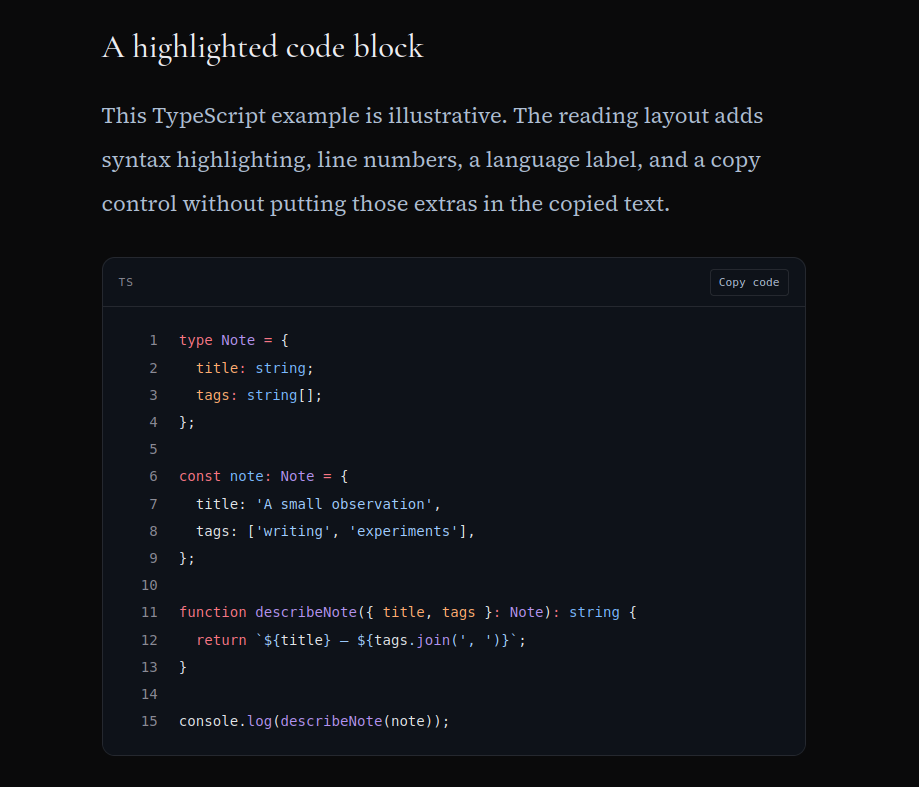

Other language names include `js`, `python`, `bash`, `json`, and `css`. Syntax highlighting and line numbers are automatic; a copy button is added when JavaScript is available. **Do not add line numbers to the source yourself.** Copied text excludes the line numbers and toolbar.

Use `text` for plain output. Indentation is preserved, and long lines scroll horizontally inside the block. The playground pairs this output with a deliberately long JSON line:

````md
Plain output should remain easy to distinguish from prose:

```text
A small observation — writing, experiments
```

The next example deliberately contains a long line. It should scroll inside the code block while the rest of the article stays within the viewport.

```json
{ "title": "An intentionally long example", "description": "This single line is long enough to test horizontal scrolling in a code block on a narrow screen without forcing the surrounding page to become wider.", "tags": ["temporary", "authoring", "design"] }
```
````

**Rendered example — phone:** the output and JSON stay inside their blocks while the article fits the screen. Capture “Plain output and long lines” for `ag_img_12.png`; leave the JSON at the start of the line so its clipping is visible. A static image shows the appearance; try scrolling the live block to check the behavior.

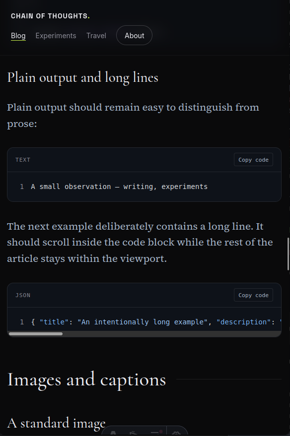

## Images

Keep the file in the article's own `images/` directory and use a path relative to `index.md`. This is the playground's standard image and italic caption:

```md


*A reused illustration from The First Commit, shown here with a simple italic caption.*
```

**Rendered example:** an image inside the reading column with a simple italic caption below. Capture both in `ag_img_13.png`.

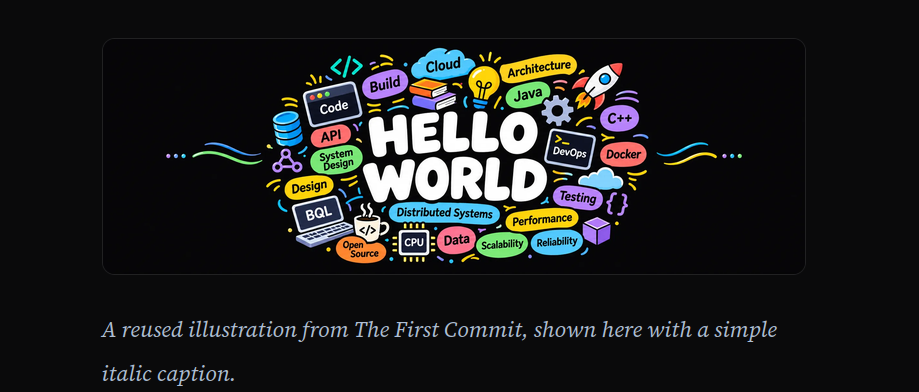

Add the actual image file before building. Use meaningful alt text, especially for diagrams; describe the information the reader needs rather than just writing “image” or “screenshot.” Normal images stay centered within the text column, retain their proportions, and receive the shared border and corner radius. Small images are not automatically stretched. The italic caption is a separate paragraph.

Use Markdown image syntax for local content assets. Do not write ``; Astro needs the Markdown reference to resolve and process the file.

### Wide image with a caption

Use this for a diagram that needs more width than the reading column. This is the playground's figure:

```md
<figure class="wide-media">


<figcaption>The loop connects curiosity, experiments, and notes. This is a temporary placeholder diagram, not a photograph.</figcaption>
</figure>
```

**Rendered example:** the diagram extends beyond the prose column and uses a dedicated caption. For `ag_img_14.png`, include a paragraph above or below it so the wider treatment is visible. Capture this at desktop width.

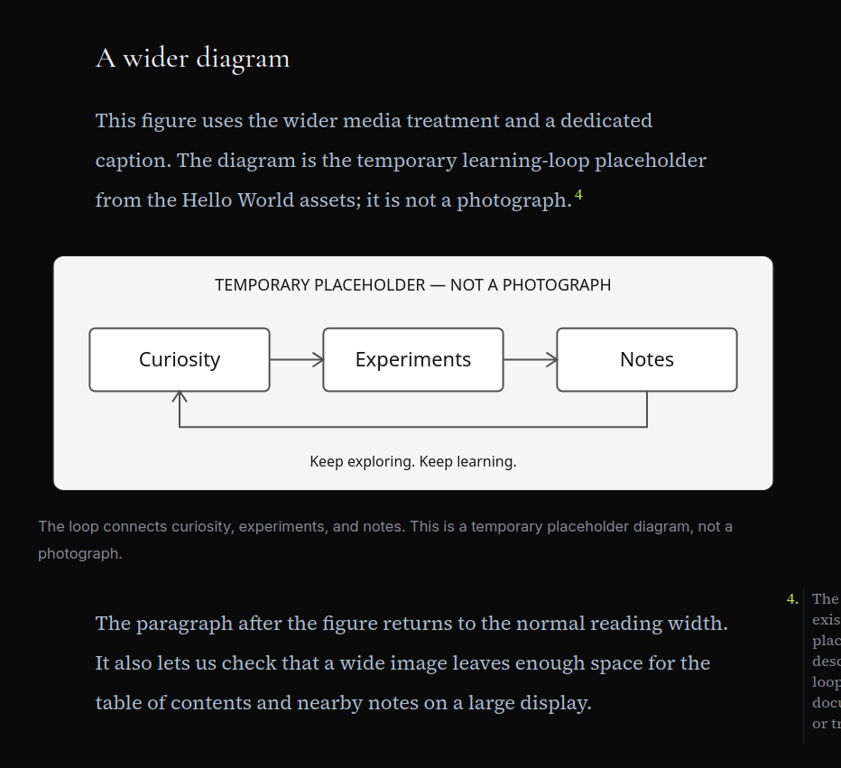

**Keep the blank lines around the Markdown image.** They allow Markdown processing inside the HTML figure. The `figcaption` is optional; remove its whole line if no caption is needed. Wide images fit the viewport on mobile and keep the same image border and radius. The learning-loop SVG is an existing placeholder, not a photograph.

### Cover image

Add this optional block to the frontmatter, between the `---` lines:

```yaml
cover:
  image: ./images/hello-world.png
  alt: "Hello World lettering surrounded by colorful illustrations of code, cloud computing, architecture, and software tools."
```

**Rendered example:** the cover sits below the title and metadata, before the article body. Reuse `ag_img_01.png` here; you do not need to take another image.


Both `image` and nonempty `alt` are required when a cover is supplied. A cover is optional; ordinary body images work without one.

## Tables

This is the complete “Tables” section from the playground. Capture its introductory paragraph, header, and first three rows as listed in the screenshot checklist:

```md
## Tables

Tables use Inter independently of the serif article text. This one provides a compact inventory of the elements on the page. On a narrow screen, the table should scroll inside its own bounds.

| Element | What this article demonstrates | What to inspect |
| :--- | :--- | :--- |
| Article header | Title, description, published date, updated date, tags, and cover | Hierarchy and spacing |
| Headings | H2 through H6 with H2/H3 navigation | Anchors and header clearance |
| Body text | Paragraphs, bold, italic, strikethrough, and inline code | Reading rhythm and wrapping |
| Lists | Bullets, numbers, and nested items | Indentation and spacing |
| Quotations | Simple blockquote and labeled, attributed card | Typography and source links |
| Notes and links | Multiple footnotes, a reused note, internal links, and reference-style links | Margin placement and return links |
| Code | Highlighted TypeScript, plain output, and a long JSON line | Line numbers, copying, and scrolling |
| Images | Cover, standard image, italic caption, and wide figure | Proportions, alt text, and captions |
| Divider | A horizontal rule between paragraphs | Separation between thoughts |
```

**Rendered example:** a sans-serif table with a shaded header and row separators, surrounded by serif prose. For `ag_img_15.png`, include the introductory paragraph, column headings, and at least the first three rows. On a phone, also check the live table's horizontal scrolling.

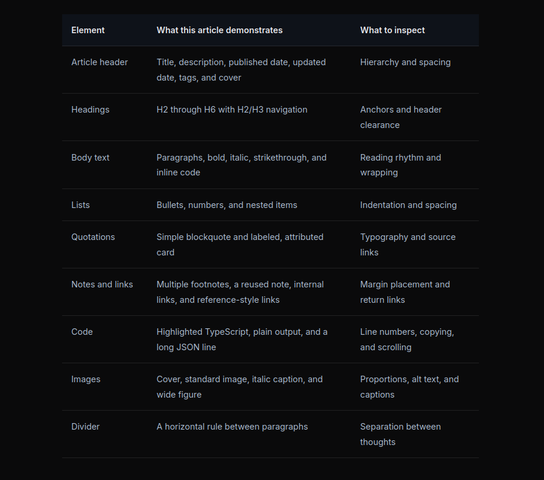

The first row becomes the table header. The separator row is required. Tables use Inter for headers and cells, independently of the article's serif body text. Wide tables scroll horizontally on small screens.

## A break between topics

A line containing three hyphens creates a horizontal divider. This is the playground's example:

```md
Sometimes a thought ends without needing another heading. A horizontal rule gives the reader a pause before the next paragraph.

---

This is the paragraph after the divider. It returns to ordinary prose so the break can be judged in context, rather than appearing alone as a decorative sample.
```

**Rendered example:** a thin line with space above and below. Capture the two paragraphs and the line between them in “A pause between thoughts” for `ag_img_16.png`.

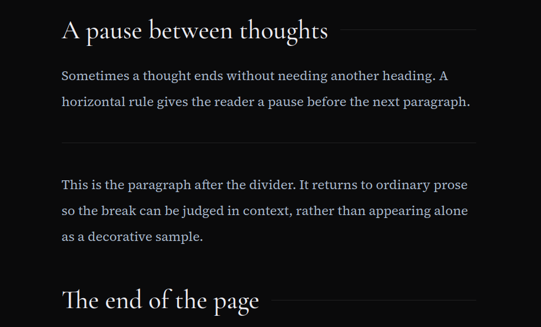

Use it between body paragraphs, outside the frontmatter. Most sections only need a heading and normal paragraph spacing.

## Preview and publish

From the repository root:

```bash
npm run dev -- --background
```

Use the URL printed by Astro; it is normally `http://localhost:4321`, but another port may be selected. Open your article's route, such as `/blog/your-article/`, on that server to preview your writing. The entry must have `draft: false` for its route to exist. The temporary playground route has been removed; its examples remain available in this guide and the saved screenshots.

```bash
npm run astro -- dev status
npm run astro -- dev logs
npm run build
```

Before committing an article:

- Read it on desktop and a narrow screen; check headings, tables, code, and image proportions.
- Check links, numbered notes, return links, alt text, and quote attribution.
- Confirm the slug and draft setting match your publishing intent.
- Run `npm run build` and fix errors. A successful build validates metadata, but does not replace reading and visually reviewing the page.
- Review `git diff` and `git status`. Commit only the article and its intended assets.

Stop the background server when finished:

```bash
npm run astro -- dev stop
```

Experiments and adventures use the same Markdown elements, with different frontmatter. See [README.md](README.md#experiments) for those schemas and collection-specific routes. Experiments share the blog reading layout; Travel uses the existing adventures collection.

## Screenshot capture checklist

### Screenshot review

All sixteen files have been visually inspected, and the revised captures now match their intended examples. The final `ag_img_12.png` shows “Plain output and long lines” at phone width, including the complete plain-text output and the long JSON line contained within its horizontally scrolling code block. No required screenshot replacements remain.

The other captures are usable as supplied. Optional cleanup: include the introductory serif paragraph in `ag_img_15.png` to show the table/body font difference; crop the partial developer toolbar off the bottom of `ag_img_09.png`; crop `ag_img_10.png` down to its final linked paragraph if you prefer a more focused example. The side-by-side collapsed/expanded phone contents in `ag_img_03.png` are useful as supplied.

### Capture instructions

These screenshots were captured from the temporary playground before it was removed from the blog. They are saved as PNGs in **`docs/images/author-guide/`**; for example, the first file is `docs/images/author-guide/ag_img_01.png`. The filenames below are used in this guide's image links. Keep these documentation images with the guide. If you refresh a screenshot later, preview the corresponding example locally in an article and replace the image using the same filename.

Use a desktop viewport at least **1,440 CSS pixels wide** for desktop captures so the left contents and right notes are both available. Use **390 CSS pixels wide**, or a similar phone width below 768px, for phone captures. Keep browser zoom at 100%, let fonts and images load, and crop to the relevant rendered article area. Keep enough surrounding text to show spacing; use a tall capture where needed. The images should show the rendered webpage, rather than the Markdown source editor.

| Filename | View | What to capture |
| :--- | :--- | :--- |
| `ag_img_01.png` | Desktop | Top of the article: title, description, published/updated dates, tags, and full Hello World cover. Reused for the cover example. |
| `ag_img_02.png` | Desktop | “Paragraphs and emphasis” through the H6 heading, with the left table of contents expanded. Use a tall crop if needed. |
| `ag_img_03.png` | Phone | Expanded table of contents above the first body paragraphs. |
| `ag_img_04.png` | Desktop | First two paragraphs of “Paragraphs and emphasis,” including bold, italic, strikethrough, and inline code. |
| `ag_img_05.png` | Desktop | “Lists and sequences”: both the bulleted and numbered lists, including nested items. |
| `ag_img_06.png` | Desktop | “A simple blockquote”: the complete bordered two-paragraph quotation. |
| `ag_img_07.png` | Desktop | “A labeled quote card”: label, quotation, and source line together. |
| `ag_img_08.png` | Desktop | “References and supporting notes”: the reference paragraphs and right-margin notes together, including note numbers and return links. |
| `ag_img_09.png` | Phone | Notes at the article end, after “The end of the page,” with numbers and return links visible. |
| `ag_img_10.png` | Desktop | Final paragraph of “References and supporting notes,” showing the lime underlined links. |
| `ag_img_11.png` | Desktop | “A highlighted code block”: the complete TypeScript block with language label, line numbers, and Copy code button. |
| `ag_img_12.png` | Phone | “Plain output and long lines”: text output and the long JSON block at its initial scroll position. |
| `ag_img_13.png` | Desktop | “A standard image”: full Hello World body image and italic caption. |
| `ag_img_14.png` | Desktop | “A wider diagram”: learning-loop figure, caption, and adjacent prose to show the width difference. |
| `ag_img_15.png` | Desktop | “Tables”: serif introductory paragraph, table headers, and at least the first three rows. |
| `ag_img_16.png` | Desktop | “A pause between thoughts”: paragraphs above and below the horizontal divider. |
