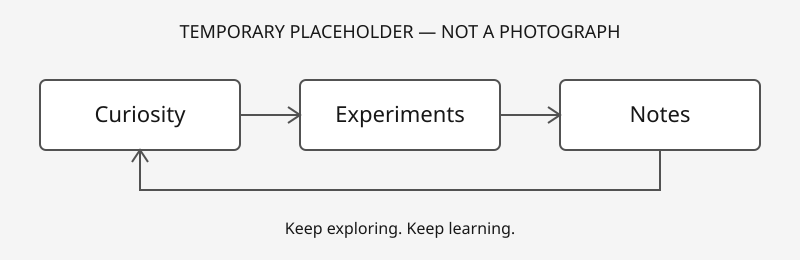

Welcome to **Chain of Thoughts**. This is a personal space to write things down, try ideas, and pay closer attention to the world.

I'll use it to share:

- **Software engineering thoughts:** decisions, questions, and lessons from building software.
- **Technical experiments:** small explorations of tools and ideas, including what works and what doesn't.
- **Landscape photography:** photographs and observations from time spent outside.
- **Personal exploration and learning:** notes on unfamiliar subjects and the connections between them.

## A small beginning

There is no grand conclusion to start with. The aim is to keep learning and leave a useful record along the way.

*This diagram is a temporary placeholder used to check local Markdown image references. It is not a real photograph.*
