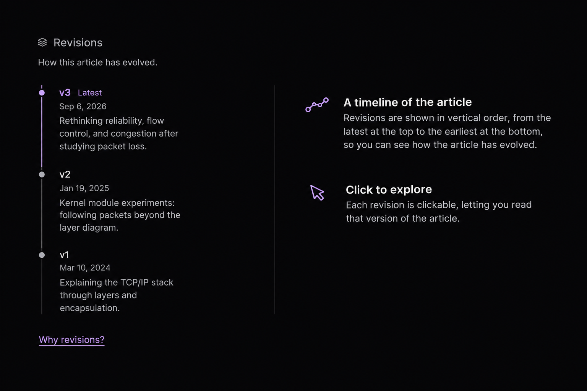

Hello World! I guess my professors taught me back in 2010 that these were the only appropriate first words for a software engineer.

## The Why

I'm starting this blog so I can write about my ideas, the tech experiments I'm running, and occasionally share some pictures from my travel adventures.

I've never been a writer, but I thought writing would help me refine my ideas and get better at communicating them. It also gives me a way to track how my thinking and understanding of a particular topic evolve over time.

## Why Now

I've always wanted to write, but I also wanted this space to feel like my own.

My motivation to write has always been personal, rather than driven by a desire to attract readers or monetize my writing. So the writing-focused, generic UIs of Substack and Medium never felt quite right.

The effort of setting up my own tech stack always felt like a lot, and I could never quite overcome that initial inertia. However, thanks to AI, it's now much easier to turn ideas into reality, much closer to how I originally envisioned them.

## Core Principles

There's a quote by Michel de Montaigne that captures how I want to approach writing here:

> "I do not portray being: I portray passing."
>
> — Michel de Montaigne, Essays, "Of Repentance"

I want my whole blog to anchor on following two principles:

- **Intellectual Humility:** My understanding of a subject might be incomplete or incorrect.
- **Growth Mindset:** I can deepen and refine my understanding through learning and experimentation.

So my articles aren't necessarily conclusions. They're snapshots of my understanding at a particular point in time.

Each article will have a start date and may go through one or more revisions as my understanding evolves. You'll be able to explore previous revisions using the revision history alongside each article.

Even this article, which explains why I'm writing today, might evolve as my motivations change over time.

I don't really know what this blog will look like a few years from now. Maybe I'll be writing about entirely different things, or maybe I'll still be exploring the same topics with a better understanding. Either way, I think it'll be interesting to look back and see how things have changed.

I don't write because I have everything figured out. I write because I'm trying to figure things out, and I want to document how my understanding evolves.

And I guess this is as good a place to start as any.
